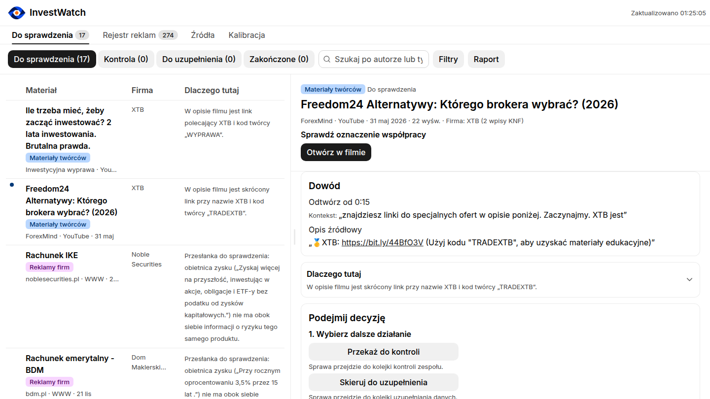
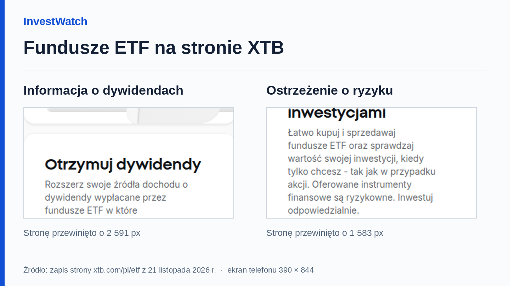
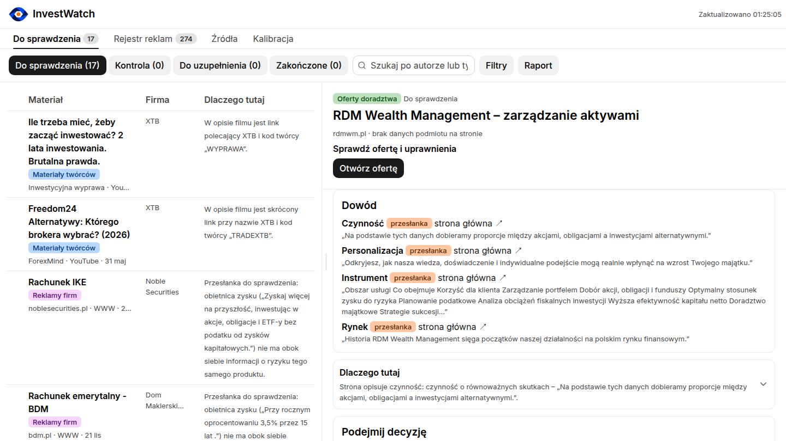
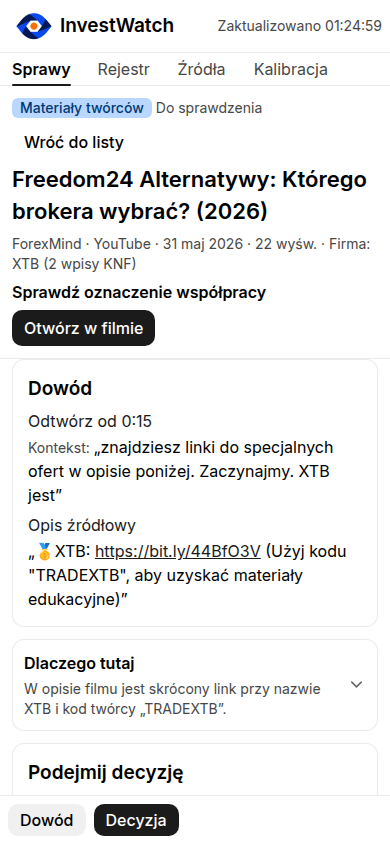
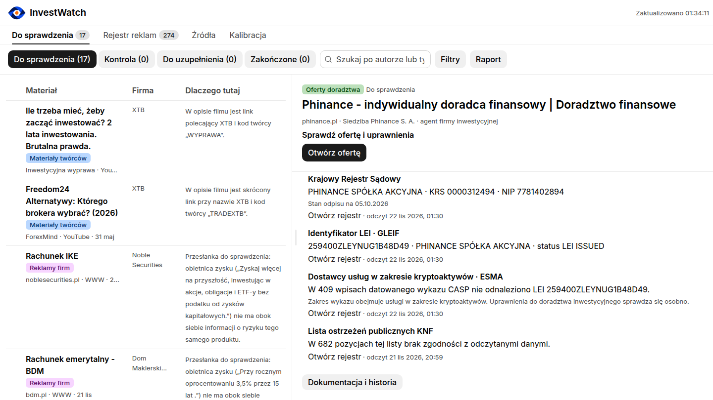

# U Źródła

**Monitoring reklam i ofert inwestycyjnych dla analityka UKNF.** U Źródła wyszukuje materiały z polskiego rynku i prowadzi od sygnału do konkretnej sekundy filmu, zapisanego widoku reklamy albo cytatu z oferty. Analityk może przy tym samym dowodzie zapisać decyzję i przekazać sprawę dalej.

[Film dla jury · 1:56](presentation/film/U-Zrodla-116s-zespol-AI.mp4) · [Uruchom pokaz](#uruchom-pokaz) · [Dokumentacja](docs/README.md)



## 13 690 materiałów

Stan pulpitu z **22 listopada 2026 r.** obejmował **13 690 materiałów**, **2 959 pozycji w rejestrze reklam** i **16 spraw do sprawdzenia**. Rejestr zawiera 2 411 pozycji rozpoznanych przez system i 548 kandydatów. To migawka po rozszerzeniu zbioru m.in. o starsze publikacje kanałów z wykrytymi współpracami. [Stan zbioru i sposób doboru](docs/hackathon/demo.md)

Paczka do odtworzenia z **21 listopada** ma **1 922 materiały**, **274 pozycje w rejestrze** i **17 spraw do sprawdzenia**. Obejmuje 1 307 filmów YouTube, w tym 23 z pełną transkrypcją, oraz **494 materiały Meta** z datowanej próbki zewnętrznej: 350 postów z Instagrama, 30 wpisów z Facebooka i 114 reklam wyszukanych z filtrem kraju emisji „Polska”. [Pochodzenie i pokrycie źródeł](docs/MONITORING.md)

## Trzy rodzaje spraw

| Co sprawdza analityk | Co pokazuje pulpit |
| --- | --- |
| **Materiały twórców · M1** | Comparic nazywa XTB partnerem odcinka w **10:14**. ForexMind kieruje widzów do ofert w **0:15**, a w opisie podaje kod TRADEXTB. W drugiej sprawie analityk może zlecić sprawdzenie oznaczenia w obrazie. |
| **Reklamy firm · M2** | Przy haśle „Otrzymuj dywidendy” karta pokazuje ostrzeżenie dla tego samego produktu i jego położenie na ekranie telefonu. Moduł ma **19 kontroli** opartych na załączniku UKNF. |
| **Oferty doradcze · M3** | Karta wskazuje cytat o indywidualnym doborze proporcji portfela. Osobno pokazuje, co udało się ustalić o operatorze i zakresie uprawnień. |

### Od dowodu do decyzji

Analityk otwiera fragment filmu, zapisuje uzasadnienie i przekazuje sprawę do kolejki kontroli. Historia zachowuje wersję materiału, na której oparł decyzję.


<table>
<tr>
<td width="50%"><br><strong>Reklama ETF</strong> · korzyść i ostrzeżenie na zapisanym widoku.</td>
<td width="50%"><br><strong>Oferta doradcza</strong> · cytat o indywidualnym doborze portfela.</td>
</tr>
</table>

<details>
<summary>Zobacz kalibrację, źródła i pulpit na telefonie</summary>

Gdy próg rośnie z 30 do 50, kolejka w pokazie kurczy się z 9 do 7 spraw, a na próbie 25 stron liczba przeoczeń rośnie z 3 do 5.


<table>
<tr>
<td></td>
<td></td>
</tr>
</table>


</details>

## Modele działają lokalnie

Vosk odczytuje mowę, E5 wspiera klasyfikację materiału, a Qwen3.5 4B w lokalnej Ollamie daje drugą opinię. Gdy Ollama jest niedostępna, reguły i pozostałe modele nadal działają. OpenRouter służył do eksperymentów porównawczych. Oficjalne API YouTube dostarcza publikacje w trybie live.

Na Linuksie z Compose przygotuj wagi przez `sh ops/inference/pull-model.sh`. Na Apple Silicon możesz uruchomić Ollamę natywnie. [Przygotowanie Ollamy](ops/demo/README.md#lokalny-model-ollama) · [Przepływ danych](docs/ARCHITEKTURA.md)

## Uruchom pokaz

Na Linux x86_64 lub macOS Apple Silicon przygotuj Docker Compose, Node.js 22.13+ i około 10 GiB miejsca. Na Linux potrzebujesz również Pythona 3.12 z venv i pip oraz FFmpeg. W katalogu projektu umieść paczkę zespołu `replay-media-2026-11-21.tar.gz` z plikiem `.sha256`. [Paczki i warianty uruchomienia](ops/demo/README.md)

```sh
sh ops/demo/start.sh
```

Po komunikacie **GOTOWE** otwórz [pulpit na porcie 8769](http://127.0.0.1:8769/), wyszukaj ForexMind i kliknij wiersz. Pierwsze przygotowanie pobiera zależności i modele. Gotowy pokaz można odtworzyć offline.

## Dokumentacja

- [Scenariusz pokazu i pytania jury](docs/hackathon/demo.md)
- [Architektura](docs/ARCHITEKTURA.md) i [źródła danych](docs/MONITORING.md)
- [Kryteria odbioru UKNF](docs/ODBIOR-UKNF.md) i [wyniki prób](fixtures/validation/INWENTARZ.md)
