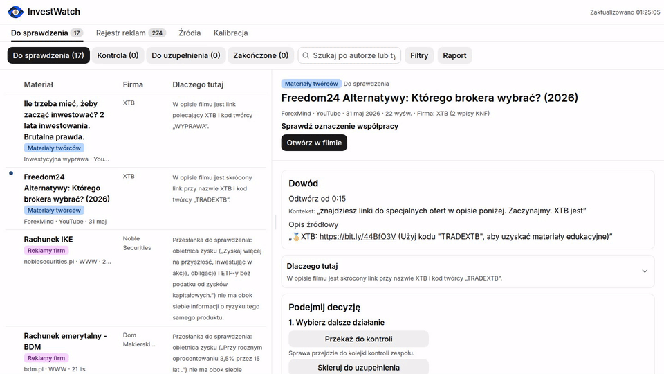
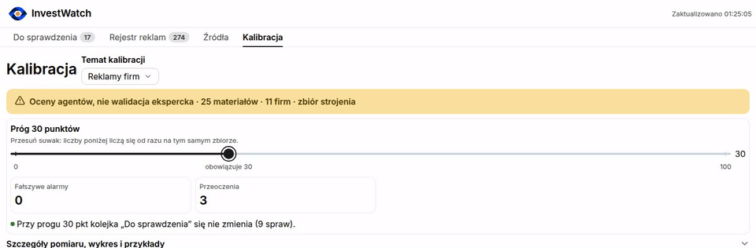
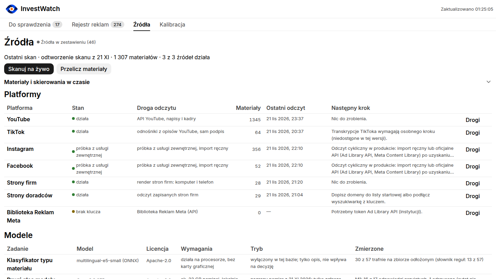

# U Źródła

**Monitoring reklam i ofert inwestycyjnych dla analityka UKNF.** U Źródła wyszukuje materiały z polskiego rynku i prowadzi od sygnału do konkretnej sekundy filmu, zapisanego widoku reklamy albo cytatu z oferty. Analityk może przy tym samym dowodzie zapisać decyzję i przekazać sprawę dalej.

[Film dla jury · 2:00](presentation/film/U-Zrodla-platformy-final.mp4) · [Uruchom pokaz](#uruchom-pokaz) · [Dokumentacja](docs/README.md) · [Jak pracowaliśmy z AI](docs/PROCES-AI.md)


## Bieżący monitoring źródeł

U Źródła jest gotowe do pracy od pobrania publikacji po zapis decyzji analityka. Jeden pulpit obsługuje **YouTube, TikToka, Instagram, Facebook, Bibliotekę reklam Meta oraz strony firm inwestycyjnych**. Skan można uruchomić na żądanie lub cyklicznie.

| Źródło | Jak pobieramy bieżące materiały |
| --- | --- |
| **YouTube** | Oficjalne API wyszukuje kanały i nowe filmy oraz pobiera ich opisy. Osobna ścieżka zbiera dostępne transkrypcje i kadry. |
| **TikTok** | Kolektor czyta podpisy publikacji z publicznych osadzeń monitorowanych profili. |
| **Instagram i Facebook** | Osobno uruchamiany kolektor pobiera bieżące posty z wybranych kont i stron przez usługę zewnętrzną. Pulpit przyjmuje też zapisane materiały z obu platform. |
| **Biblioteka reklam Meta** | Adapter pobiera reklamy z Facebooka i Instagrama po skonfigurowaniu uprawnionego tokenu. |
| **Strony WWW** | Kolektory czytają reklamy i oferty. Karta zachowuje źródłowy cytat, zrzut strony albo pomiar położenia ostrzeżenia. |

Pulpit pokazuje datę ostatniego odczytu, zakres zebranych materiałów i stan dostępu do źródła. [Konfiguracja monitoringu i dostęp do platform](docs/MONITORING.md)

## Trzy rodzaje spraw

| Co sprawdza analityk | Co pokazuje pulpit |
| --- | --- |
| **Materiały twórców · M1** | Comparic nazywa XTB partnerem odcinka w **10:14**. ForexMind kieruje widzów do ofert w **0:15**, a w opisie podaje kod TRADEXTB. W drugiej sprawie analityk może zlecić sprawdzenie oznaczenia w obrazie. |
| **Reklamy firm · M2** | Przy haśle „Otrzymuj dywidendy” karta pokazuje ostrzeżenie dla tego samego produktu i jego położenie na ekranie telefonu. Moduł ma **19 kontroli** opartych na załączniku UKNF. |
| **Oferty doradcze · M3** | Karta wskazuje cytat o indywidualnym doborze proporcji portfela. Osobno pokazuje, co udało się ustalić o operatorze i zakresie uprawnień. |

### Od dowodu do decyzji

Analityk otwiera fragment filmu, zapisuje uzasadnienie i przekazuje sprawę do kolejki kontroli. Historia zachowuje wersję materiału, na której oparł decyzję.



<table>
<tr>
<td width="50%"><br><strong>Reklama ETF</strong> · korzyść i ostrzeżenie na zapisanym widoku.</td>
<td width="50%"><br><strong>Oferta doradcza</strong> · cytat o indywidualnym doborze portfela.</td>
</tr>
</table>

<details>
<summary>Zobacz kalibrację, źródła i pulpit na telefonie</summary>

Gdy próg rośnie z 30 do 50, kolejka w pokazie kurczy się z 9 do 7 spraw, a na próbie 25 stron liczba przeoczeń rośnie z 3 do 5.



<table>
<tr>
<td></td>
<td></td>
</tr>
</table>


</details>

## Modele działają lokalnie

Vosk odczytuje mowę, E5 wspiera klasyfikację materiału, a Qwen3.5 4B w lokalnej Ollamie daje drugą opinię. Gdy Ollama jest niedostępna, reguły i pozostałe modele nadal działają.

Na Linuksie z Compose przygotuj wagi przez `sh ops/inference/pull-model.sh`. Na Apple Silicon możesz uruchomić Ollamę natywnie. [Przygotowanie Ollamy](ops/demo/README.md#lokalny-model-ollama) · [Przepływ danych](docs/ARCHITEKTURA.md)

## Uruchom pokaz

Uruchom bieżący monitoring na przygotowanym stanowisku z Docker Compose:

```sh
sh ops/demo/start.sh --live
```

Otwórz [lokalny pulpit](http://127.0.0.1:8769/) i wybierz **Źródła**, żeby zobaczyć wynik skanu. Instrukcja opisuje konfigurację dostępu oraz pokaz offline. [Przygotowanie stanowiska](ops/demo/README.md)

## Dokumentacja

- [Scenariusz pokazu i pytania jury](docs/hackathon/demo.md)
- [Architektura](docs/ARCHITEKTURA.md) i [źródła danych](docs/MONITORING.md)
- [Kryteria odbioru UKNF](docs/ODBIOR-UKNF.md) i [wyniki prób](fixtures/validation/INWENTARZ.md)
