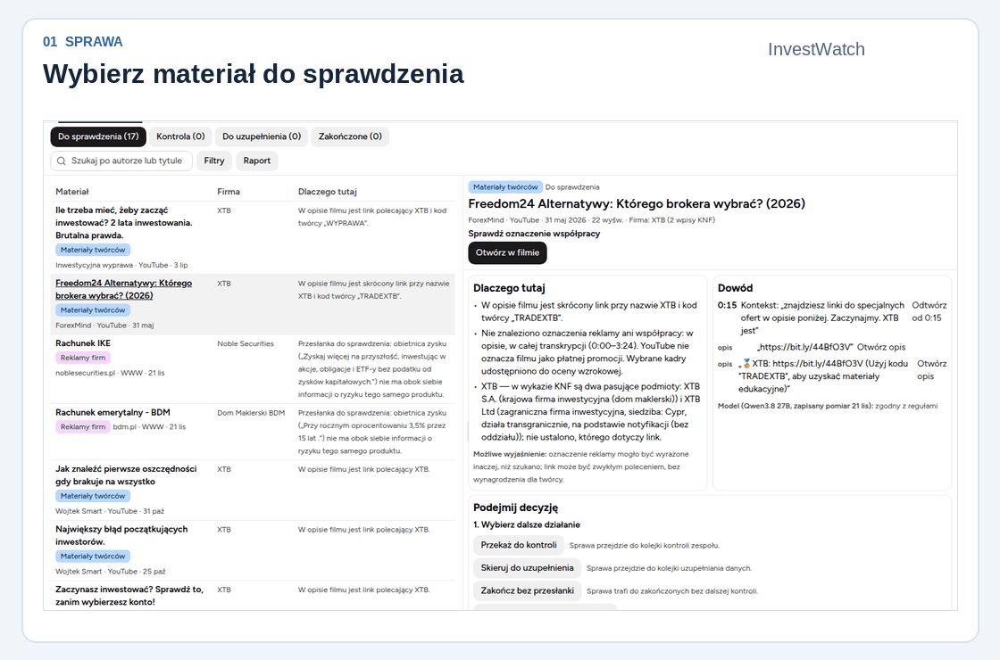
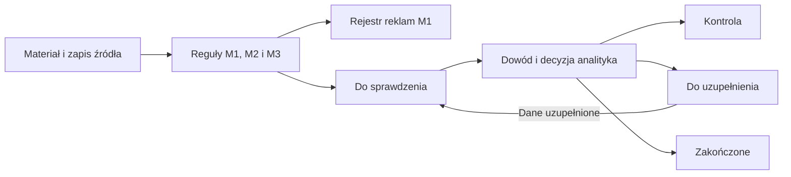
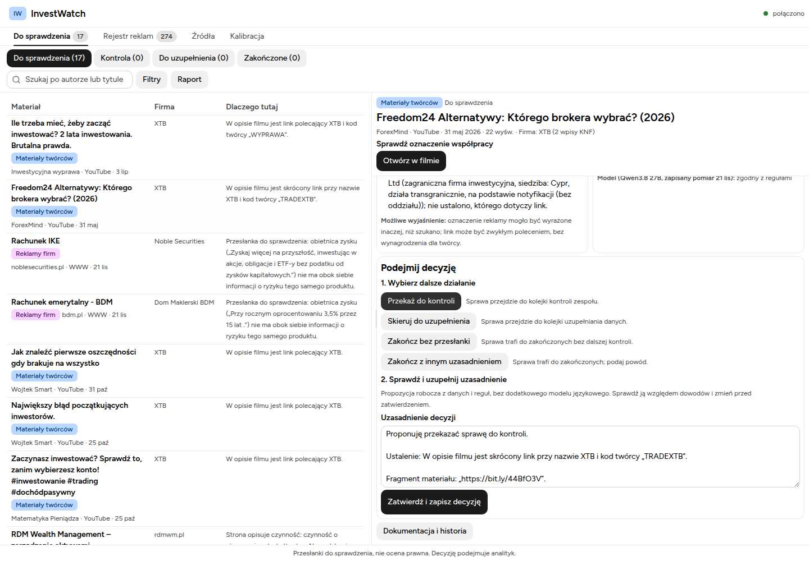
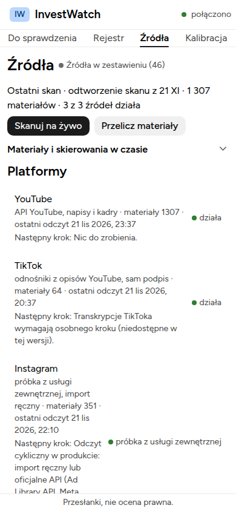
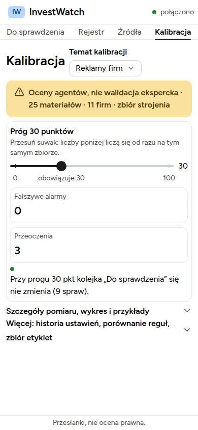

# InvestWatch · od publikacji do decyzji analityka

InvestWatch pomaga analitykom UKNF znaleźć materiały inwestycyjne wymagające sprawdzenia. Z kolejki analityk przechodzi do konkretnej sekundy nagrania, zapisanego widoku reklamy lub cytatu z oferty. Zatwierdzona decyzja zostaje przy wersji materiału, którą sprawdził.



[Scenariusz w 2 minuty](docs/hackathon/demo.md#pokaz-w-2-minuty) · [Prezentacja PDF](presentation/InvestWatch.pdf) · [Uruchom pokaz](#uruchom-pokaz) · [Macierz wymagań UKNF](docs/ODBIOR-UKNF.md)

## Od źródła do karty

Stan pokazu z 21 listopada 2026 obejmuje **1 922 materiały**, **274 wpisy w rejestrze reklam** i **17 spraw do sprawdzenia** (7 M1, 9 M2, 1 M3). Rejestr zawiera pozycje potwierdzone i do potwierdzenia. [Scenariusz i liczniki pokazu](docs/hackathon/demo.md)

| Źródło | Jak czytamy | Co widzi analityk |
| --- | --- | --- |
| **YouTube** | Oficjalne Data API v3 służy do odkrywania polskich kanałów i pobierania metadanych. Dla wybranych filmów dołączamy napisy lub zapis rozpoznanej mowy oraz kadry. | Opis, dostępne oznaczenie promocji, cytat z czasem, kadry do ręcznego przejrzenia i odsyłacz do filmu. Pełna transkrypcja jest dostępna w **23 z 1 307** filmów w pokazie. |
| **TikTok** | Profile odkrywamy z linków w opisach YouTube, a ostatnie publikacje odczytujemy z publicznych osadzeń. | Podpisy i adresy **64 postów** z sześciu polskojęzycznych profili. Odczyt obejmuje podpisy i metadane. |
| **Facebook** | Pokaz czyta datowaną próbkę zewnętrzną. Publiczny profil bez logowania udostępnia metadane profilu. | Tekst i dostępne wskaźniki reakcji. Próbka wpisów organicznych obejmuje **30 wpisów z 10 stron**. |
| **Instagram** | Pokaz czyta datowaną próbkę zewnętrzną. Można też zaimportować zapisane osadzenie publicznego profilu. | Podpis i dostępna flaga płatnej współpracy. Próbka wpisów organicznych obejmuje **350 postów z 31 kont**. |
| **Biblioteka Reklam Meta** | Pokaz czyta zapisaną próbkę reklam na Facebooku i Instagramie kierowanych do odbiorców w Polsce. Oficjalny adapter wymaga tokenu Meta. | **114 reklam**, z treścią, reklamodawcą i datami emisji. Ocena dotyczy dostępnego tekstu i metadanych. |
| **Strony WWW i wykazy KNF** | Oferty M2 odkrywamy z odsyłaczy na stronach firm i renderujemy w Chromium. M3 czyta strony z przygotowanych wyników wyszukiwania i sprawdza dane w datowanych wykazach. | Zrzut i pomiar ostrzeżenia w reklamie albo cytat z oferty, dane operatora i zakres znalezionego zezwolenia. |
| **Apple Podcasts i RSS** | Katalog Apple wskazuje audycje po polskich frazach. Kanały RSS pozwalają śledzić kolejne odcinki. | Opis, datę i adres odcinka. Dla wybranej audycji tryb live może dołączyć transkrypcję początku nagrania. |
| **PeerTube** | Wyszukiwanie po polskich tematach odkrywa filmy i kanały. | Opis filmu, adres i drogę odkrycia. |

Po uwzględnieniu reklam stan pokazu obejmuje **143 materiały z Facebooka i 351 z Instagrama**. [Monitoring i zakres dostępu](docs/MONITORING.md) · [Pochodzenie próbki Meta](docs/lanes/2026-11-21-fable-k-social.md#co-zawiera-próbka-replay-replay-vendorjsongz-494-materiały)

## Trzy pytania nadzorcze

- **M1 · Czy twórca ujawnił współpracę?** ForexMind ma w opisie link i kod XTB, a w **0:15** odsyła do ofert. Karta łączy te przesłanki i prowadzi do materiału. W podobnym przypadku Comparic wskazuje partnera odcinka w **10:14**, więc film trafia do rejestru reklam. Zwykła opinia bez przesłanki relacji handlowej pozostaje poza kolejką. [Temat 1](docs/zrodla-uknf/TEMAT-1.md) · [Przykłady w pokazie](docs/hackathon/demo.md#pokaz-w-2-minuty)
- **M2 · Czy klient widzi ryzyko obok informacji o zysku?** InvestWatch sprawdza **19 pozycji** z załącznika UKNF. W sprawie ETF XTB zapis pokazuje informację o dywidendach i położenie ostrzeżenia dotyczącego ETF na komputerze i telefonie. Ostrzeżenie CFD przypisujemy do kontraktów CFD. Pulpit pokazuje wynik, zrzut i pomiar dla sprawdzanego widoku. [Kryteria i dowód M2](docs/zrodla-uknf/KRYTERIA-M2.md#dowód-w-działającym-m2)
- **M3 · Czy oferta opisuje spersonalizowane doradztwo i kto ją składa?** Na rdmwm.pl cytat wskazuje dobór proporcji akcji i obligacji na podstawie danych klienta. Karta pokazuje przesłankę doradztwa i nieustaloną tożsamość operatora. W kontroli DM BOŚ znaleziony wpis potwierdza zakres doradztwa. Sama zbieżność nazw zostawia tożsamość do wyjaśnienia. [Temat 3](docs/zrodla-uknf/TEMAT-3.md) · [Próba M3](docs/lanes/2026-11-21-fable-f-m3.md)

## Decyzja i dalsza praca



Po wyborze działania pulpit przygotowuje edytowalny szkic uzasadnienia z dowodów w karcie. Analityk zatwierdza zapis, dodaje wyniki kontroli lub otrzymane dane i może wrócić ze sprawą do oceny. Przekazanie zmienia kolejkę wewnątrz InvestWatch. Historia i eksport CSV zachowują decyzję, uzasadnienie, wersję materiału i adres źródła. Pulpit powiadamia o nowych sprawach wysokiego ryzyka i aktualizuje widok po zapisie decyzji. [Obieg sprawy](docs/hackathon/demo.md#gdzie-trafia-sprawa) · [Kontrakt decyzji i raportu](docs/hackathon/contracts.md#obieg-decyzji-operatora)



*Sprawa ForexMind przed zatwierdzeniem.* [Karta na telefonie](tests/ui/screens/2026-11-22-final-workflow/390-forexmind.png) · [Sprawa w kolejce Kontrola po zapisie](tests/ui/screens/2026-11-22-final-workflow/1440-kontrola.png)

## Co sprawdziliśmy

| Próba | Wynik i zakres wniosku |
| --- | --- |
| **Odkrywanie na YouTube** | Algorytm znalazł **3 z 5** największych kanałów z odłożonej listy. Cel próby wynosił 4 z 5. [Wynik Y](fixtures/validation/y-reference/WYNIK-Y-2026-11-21.md) |
| **M1 · kwalifikacja** | Przy progu 60 reguły poprawnie skierowały **4 z 4** materiałów z przesłanką w zbiorze strojenia (26 materiałów, 20 kampanii). Zero fałszywych alarmów, a wszystkie trzy dodatnie kampanie dotyczyły XTB. W późniejszej ślepej próbie do kolejki **Do sprawdzenia** trafiło **0 z 8** filmów, zgodnie z etykietami. Próba zawierała osiem kontroli ujemnych, więc precyzja i pełność są tam nieobliczalne. [Strojenie M1](fixtures/validation/q-v2/WYNIK-M1-2026-11-21.md) · [Próba diagnostyczna](docs/lanes/2026-11-22-proba-kampanii.md) |
| **M2 · próg** | Na **25 stronach 11 firm** próg 30 dał 9 trafnych skierowań, 0 fałszywych alarmów, 13 poprawnych odrzuceń i 3 przeoczenia. Przy progu 50 liczba przeoczeń wzrosła do 5. W pulpicie można odtworzyć to porównanie. [Próba M2](docs/lanes/2026-11-21-fable-e-m2.md) |
| **M3 · oferta i operator** | Odczytaliśmy **29 domen** i wykorzystaliśmy **12 datowanych wykazów**. Próba kwalifikacji obejmowała 31 materiałów, w tym kontrole. Po dostrojeniu reguł na tym zbiorze system skierował jedyny przykład oznaczony jako dodatni. [Próba M3](docs/lanes/2026-11-21-fable-f-m3.md) |
| **AI · typ materiału** | Lokalny klasyfikator E5 rozpoznał typ **30 z 57** opisów z odłożonych kanałów wobec **13 z 57** dla słownika. Reguły kwalifikacji kierują sprawy do analityka. Opcjonalny drugi głos modelu podlega weryfikacji dosłownych cytatów. [Pomiar E5](docs/lanes/2026-11-21-fable-ai-inferencja.md) · [Drugi głos](docs/lanes/2026-11-21-fable-ai-drugi-glos.md) |

Etykiety w tych próbach przygotowali agenci. Trafność w pilotażu wymaga oceny ekspertów na nowych, kompletnych kampaniach. Odbiór techniczny pokazu objął zapis decyzji, powtórzenie zapisu po utracie odpowiedzi oraz pulpit na komputerze i telefonie. [Protokół walidacji](fixtures/validation/PROTOKOL.md) · [Testy i ich zakres](tests/README.md)

| Źródła | Kalibracja M2 |
| --- | --- |
|  |  |
| Sprawdź, kiedy i jak odczytano daną platformę. [Pełny widok źródeł](tests/ui/screens/2026-11-22-final/1440-zrodla.png) | Porównaj alarmy i przeoczenia przy zmianie progu na tym samym zbiorze. [Pełny widok kalibracji](tests/ui/screens/2026-11-22-final/1440-kalibracja-m2.png) |

## Uruchom pokaz

1. Otwórz katalog repozytorium na Linux x86_64 lub macOS Apple Silicon. Przygotuj Docker Compose i Node.js **22.13+** oraz około **10 GiB** wolnego miejsca. Na Linux przygotuj też Python 3.12 z venv/pip i FFmpeg. [Instrukcja stanowiska](ops/demo/README.md) · [Procedura na Macu](ops/mac/README.md)
2. Poproś zespół o prywatną paczkę `replay-media-2026-11-21.tar.gz` z plikiem `.sha256`. Skopiuj oba pliki do katalogu projektu. Do szybkiego startu skopiuj też `investwatch-state-2026-11-21.tar.gz` z jego `.sha256`. Start wczyta gotowy stan przy pustej bazie i zgodnym odcisku kodu. [Archiwa i odtworzenie](ops/demo/README.md)
3. Uruchom z katalogu projektu.

   ```sh
   sh ops/demo/start.sh
   ```

4. Po komunikacie **GOTOWE** otwórz [pulpit InvestWatch](http://127.0.0.1:8769/). Wybierz **Do sprawdzenia**, wyszukaj **ForexMind** i otwórz dowód przy **0:15**. Sprawdź szkic pod **Przekaż do kontroli**, zatwierdź decyzję i wybierz **Otwórz w kontroli**. [Scenariusz pokazu](docs/hackathon/demo.md#pokaz-w-2-minuty)

Pierwsze przygotowanie środowiska pobiera zależności. Późniejszy pokaz korzysta z zapisanego stanu i działa offline bez płatnego API. Cytat i znacznik czasu są dostępne w karcie, a przejście do źródłowego filmu wymaga sieci. Wcześniejszy pomiar na Linux x86_64 wyniósł około 12 min od pustego stanu i 33 s z dopasowanym archiwum. Wariant bez Dockera uruchamia `sh ops/demo/start-local.sh`. [Pomiar i architektura](docs/ARCHITEKTURA.md) · [Uruchomienie lokalne i tryb live](ops/demo/README.md)

## Dokumentacja

[Wymagania źródłowe UKNF](docs/zrodla-uknf/README.md) · [Architektura i punkty rozszerzeń](docs/ARCHITEKTURA.md) · [Proces pracy z AI](docs/PROCES-AI.md) · [Mapa repozytorium](docs/README.md)
