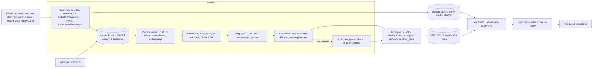

# Architektura InvestWatch

Cały stos działa on-premise, na otwartym oprogramowaniu i bez płatnych API. Jedna komenda `sh ops/demo/start.sh` uruchamia lekkie serwisy z [compose.yaml](../compose.yaml). Dane trzymamy w SQLite i w magazynie plików na dysku.

## Przepływ danych

## Serwisy

| Serwis | Rola | Obraz | Port | Wolumeny | Skalowanie |
|---|---|---|---|---|---|
| `web` | Statyczny pulpit (`web/`) i reverse proxy dla `/v1` (REST, WebSocket), `/uploads`, `/evidence`, `/media` | `nginx:1.27-alpine` (BSD-2) | **jedyny** port na hoście: `127.0.0.1:8769` | `web/` (ro), `ops/web/nginx.conf` (ro) | Bezstanowy, można go powielić za balanserem |
| `api` | FastAPI: sprawy, decyzje, kalibracja progu, raporty, strumień zdarzeń | `python:3.12-bookworm` + zależności z `.runtime` (ro) | brak, tylko sieć `backend` | `state`, `objects`, kod (ro) | Wiele replik do odczytu. Zapisy przechodzą przez jednego pisarza SQLite |
| `worker` | Kolektory i analiza, pobiera zadania z kolejki | jak `api` | brak | `state`, `objects`, `replay-media` (ro), modele (ro) | `--scale worker=N`: zadanie trzyma dzierżawa (`api/jobs.py: claim`, `LEASE`), a po awarii przejmuje je inny worker |
| `scheduler` | Co `INVESTWATCH_DISCOVERY_INTERVAL` s zleca skan live (rola CronJob). Idempotentny identyfikator okna | jak `api`, 256 MB | brak | `state` | Jedna instancja wystarcza. Druga nie dubluje skanu (unikalny `request_id`) |
| `inference` | Ollama, drugi głos LLM (profil `llm`, domyślnie wyłączony) | `ollama/ollama` (MIT), bez wag w obrazie | brak, tylko `backend` | `.runtime/ollama` (wagi poza Gitem) | Limit `mem_limit` 6 GB, jedno żądanie naraz. Na Macu Ollama działa natywnie (Metal) |

Wybór nginx zamiast Caddy: obraz ma 75 MB i jest dostępny dla amd64 oraz arm64. Był już na hoście, więc start nie wymaga dodatkowego pobierania. Do proxy wystarcza kilkanaście linii konfiguracji, a nginx nie dokłada automatycznego TLS, którego lokalne stanowisko nie potrzebuje. API sprawdza `Host` i `Origin` (TrustedHost, same-origin), więc proxy przekazuje `Host` bez zmian.

**Dane.** `state` (`/data`) zawiera `cases.sqlite3`, czyli metadane, treść materiałów, wersje, decyzje, dziennik skanów i zdarzenia, oraz przejściowy `queue.sqlite3`. `objects` montujemy w podkatalogach `/data/<uploads|m2|media-cache|meta-import|youtube-raw|youtube-cache>`, więc kod nie wymagał zmian. Przesłane nagrania (`uploads/<sha256>.<ext>`) i zasoby archiwum M2 (`<sha256>.png|json`) mają nazwę równą skrótowi SHA-256 treści, więc ta sama treść nie powstaje dwa razy. API serwuje wyłącznie nazwy w tym formacie, a skrót zasobu M2 sprawdza przy odczycie. `replay-media` to paczka 17 filmów z 21 XI, montowana tylko do odczytu i weryfikowana manifestem SHA-256 z repozytorium (`api/replay_pack.py`).

**Wąskie gardło i ścieżka wzrostu (nie wdrożona).** SQLite dopuszcza jednego pisarza naraz, co wystarcza na jedno stanowisko i kilku workerów. Przy większej skali trzeba zrobić trzy kroki: (1) SQLite zastąpić Postgresem, bo schemat i zapytania są w jednym module `api/store.py`; (2) `objects` przenieść do magazynu zgodnego z S3 (np. MinIO), bo adresowanie skrótem przechodzi bez zmian; (3) kolejkę Huey/SQLite zamienić na Huey/Redis albo inną kolejkę zewnętrzną, bo dziennik skanów i dzierżawa zostają w SQL.

**Start (devbox Linux x86_64, obciążony, 21 XI).** Czysty start `sh ops/demo/start.sh --reset --cold` do `GOTOWE` przez `web` zajmuje 701–721 s: 6 skanów bootstrapu, 1932 sprawy, jeden worker. Start z archiwum stanu (`ops/demo/pack-state.sh`, 9 MB) trwa 33 s, w tym `GOTOWE` po 23 s od `up`. Przy niezgodnym odcisku kodu skrypt ostrzega i robi normalny bootstrap. Odcisk to SHA-256 śledzonych plików `api/ analysis/ collectors/ fixtures/ data/probe-snapshots/` bez testów i `.md`.

## Punkty rozszerzeń

| Co dodać | Jak |
|---|---|
| Nowe źródło | Jeden adapter z funkcją `discover(ctx)` zwracającą materiały i stan źródła (`collectors/adapter.py: Adapter, AdapterContext`). Do tego jedna linia `register(Adapter("id", fn, "Etykieta", modes=...))` w `collectors/discovery.py`. Kwoty, dzierżawa, ponowienia i stan źródła są wspólne |
| Moduł analityczny | Funkcja oceniająca materiał w `analysis/` wywołana z `analysis/engine.py: analyze()`. Wynik trafia do wspólnego Finding, a wersję modułu zapisuje pole `analysisVersion` |
| Nowy model | E5: `analysis/semantic-lock.json` i `analysis.setup_semantic`. Klasyfikator: `python -m analysis.material_classifier train`. LLM: `INVESTWATCH_LLM_MODEL` plus `sh ops/inference/pull-model.sh MODEL` albo `ollama pull` na hoście |
| Nowy serwis | Usługa w `compose.yaml` w sieci `backend`. Wychodzi na zewnątrz tylko przez `web` |

## Bezpieczeństwo

- Na hoście nasłuchuje tylko `web` (127.0.0.1). `api`, `worker`, `scheduler` i `inference` są w sieci `internal: true`, bez drogi do Internetu. Wyjście dostaje wyłącznie `worker`, i to tylko w trybie `--live` albo przy Ollamie na hoście (nakładka `ops/compose/egress.yaml`).
- Każdy kontener: system plików tylko do odczytu, `tmpfs` na `/tmp`, użytkownik bez roota (UID hosta), `cap_drop: ALL`, `no-new-privileges`, limity CPU i pamięci, `pull_policy: never` oraz healthcheck. Kod i modele są montowane tylko do odczytu, zapis jest możliwy tylko w `state` i `objects`.
- Sekrety (np. `YOUTUBE_API_KEY`) trzymamy wyłącznie w `.env` albo w pliku poza repozytorium (`.env.example` to sam wzór). Produkt nie korzysta z płatnych API. LLM działa lokalnie (Ollama), a klucz OpenRouter służy tylko narzędziu pomiarowemu i nie trafia do workera.
- Zależności są przypięte (`api/requirements.lock`, `web/package-lock.json`) i instalowane offline z lokalnego wheelhouse. Stan audytu: [ODBIOR-UKNF.md](ODBIOR-UKNF.md), R-§5-07/08.

## Mapowanie na brief

| Wymaganie (BRIEF) | Gdzie |
|---|---|
| §3.1 kolejka zadań open source | Huey na SQLite oraz dziennik skanów z dzierżawą: `api/jobs.py` |
| §3.1 crawler, kolektory API i parsery, rotacja User-Agent i proxy, wyjście JSON | `collectors/*.py`, transport: `collectors/common.py`, przeglądarka M2: `collectors/m2_browser.py` |
| §3.1 baza metadanych SQL, baza treści SQL + Object Storage | `state/cases.sqlite3` (`api/store.py`), `objects/` adresowane SHA-256 |
| §3.1 harmonogram (CronJob/orchestrator) | serwis `scheduler` (`ops/scheduler/scheduler.py`), profil `live` |
| §3.2 preprocessing, tokeny i embeddingi | `analysis/material_classifier.py: clean_text, dedupe`, `analysis/semantic.py` (E5, ONNX) |
| §3.2 silnik inferencji i model open source, scoring | reguły i punkty M1/M2/M3: `analysis/engine.py`, klasyfikator: `analysis/material_classifier.py`, Ollama: `analysis/inference.py` + serwis `inference` |
| §3.2 agregator wyników w ujednolicone obiekty | `api/store.py: apply_scan`, wspólny Finding/Case z wersjami |
| §3.3 pulpit, filtry, trend, status, WebSocket, próg | `web/src/desk/*`, `/v1/trend`, `PATCH /v1/cases/…`, `/v1/events`, `/v1/threshold` (`api/server.py`) |
| §5 modułowe lekkie serwisy | `web`, `api`, `worker`, `scheduler`, `inference` w `compose.yaml` |
| §5 konteneryzacja, start jedną komendą | `sh ops/demo/start.sh`. Gotowy stan: `ops/demo/pack-state.sh` |
| §5 open source, on-premise, bez płatnych API | nginx, Python, FastAPI, Huey, SQLite, ONNX Runtime, Vosk, Ollama |
| §5 łańcuch dostaw, sekrety w .env | lockfile'y, offline wheelhouse, `.env.example`, sieć wewnętrzna |
