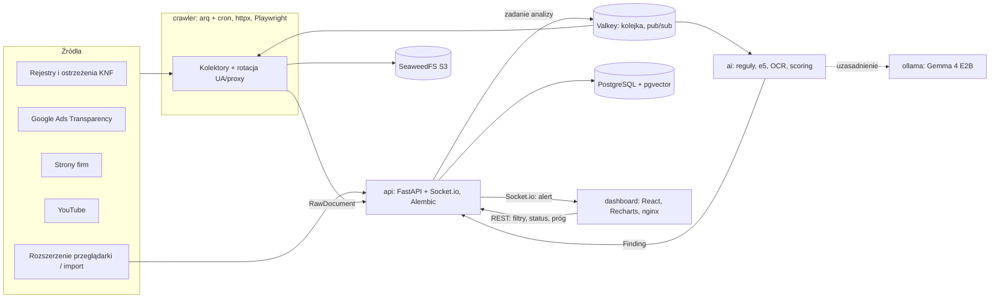

# UKNF #InvestWatch — research decyzyjny

Stan na 21.11.2026 ok. 15:00. Sondy wykonano z VPS w UE, bez logowania, kont i płatnych API. Plan rozwiązania: [PLAN.md](PLAN.md). Rundy sędziów: [JUDGING.md](JUDGING.md).

## Werdykt

**Rekomendacja: brać tylko wtedy, gdy mentor UKNF przy stoisku potwierdzi dwie rzeczy; bez tego nie brać.**

1. Jury zaakceptuje pokrycie Facebooka, Instagrama i TikToka bez automatycznego scrapingu (rozszerzenie przeglądarki dla inspektora + kolektory oficjalnych API czekające na tokeny) albo pendrive zawiera próbki z tych platform, które wystarczy wczytać.
2. Załącznik z listą wymogów do modułu 2 i próbki danych są do odebrania dziś.

Uzasadnienie:
- Dane referencyjne są dużo lepsze, niż zakładała wcześniejsza analiza („nie brać”): pełne rejestry KNF i lista ostrzeżeń pobierają się bez klucza, Google Ads Transparency zwraca realne reklamy firm inwestycyjnych w PL, YouTube działa oficjalnymi kanałami.
- Kryterium 20% (ustandaryzowany proces z asystentami AI) to nasza wyraźna przewaga: Agent Context Kit po rozszerzeniu daje dowody, których inne zespoły raczej nie będą miały.
- Sufit punktowy planu to ok. 88–92/100, nie 95–100. Trzej sędziowie dali po trzech rundach 88 / 79 / 83.
- Główne ryzyko to wykonalność: sędziowie oceniają szansę dowiezienia całego planu przez „J + agenci” na 25–35%, rdzenia na ok. 60%.
- Szansa na wygraną: szacuję 15–25% (jedna nagroda, 5–12 zespołów, 0 publicznych repo konkurencji o 14:30). To szacunek, nie pomiar: nie znamy poziomu konkurencji ani tego, jak jury potraktuje zespoły, które zescrapują FB/IG/TikTok wbrew regulaminom platform.

## 1. Dane i źródła

### Tabela źródeł

| Źródło | Moduł | Dostęp i wynik sondy | Licencja / ToS | Potrzebne od J | Plan B |
|---|---|---|---|---|---|
| KNF, rejestry podmiotów: `https://www.knf.gov.pl/api/podmioty-children?parentId=<id>&type=SUBCATEGORY\|COMPANY&page=0&pageSize=100` | 1, 2, 3 | HTTP 200, JSON bez klucza. Pobrano: 28 domów maklerskich, 10 + 17 banków, 53 TFI, 10 oddziałów zagranicznych firm, **712 notyfikacji transgranicznych** (278 z nazwą handlową lub domeną), 26 agentów-osób prawnych | Nieudokumentowane API frontendu; nota prawna KNF niesprawdzona; limitów nie znaleziono | nic | Wyszukiwarka SSR (dane w payloadzie RSC); snapshot zapisany w `data/probe-snapshots/knf/` |
| KNF, lista ostrzeżeń publicznych: `https://www.knf.gov.pl/dla_konsumenta/ostrzezenia_publiczne` | 1, 3 | HTTP 200, jedna strona HTML, 13 tabel, **669 wpisów** (435 z art. 178 ustawy o obrocie, 9 z art. 178 w zw. z art. 79) | jak wyżej | nic | snapshot w `data/probe-snapshots/knf/knf_warnings_parsed.json` |
| ESMA, rejestry (Solr): `https://registers.esma.europa.eu/solr/esma_registers_upreg/select` | 1, 2 | HTTP 200 bez klucza; 7 140 firm MiFID, 60 z siedzibą w PL, 18 oddziałów w PL. **Paszportów usługowych do PL nie da się wyprowadzić** (host member state tylko przy oddziałach); nazwy handlowe i strony prawie puste; indeks z 04.2026 | warunki ESMA niesprawdzone | nic | notyfikacje KNF (lepsze) |
| KRS Open API: `https://api-krs.ms.gov.pl/api/krs/OdpisAktualny/<KRS>?rejestr=P&format=json` | 3 | HTTP 200 bez klucza; nazwa, NIP, PKD, zarząd. **Brak wyszukiwania po nazwie** | publiczne | nic | numer KRS z ostrzeżeń KNF lub ze strony podmiotu |
| CEIDG v3, REGON BIR | 3 | 401 / wymaga klucza | — | pomijamy | KRS |
| IOSCO I-SCAN | 3 | 403 (Cloudflare) | — | pomijamy | lista KNF |
| **Google Ads Transparency Center**, region PL (kod 2616): `…/anji/_/rpc/SearchService/SearchSuggestions` i `SearchCreatives` | 2, 1, 3 | HTTP 200 bez logowania i cookies. „XTB S.A.”: 700–800 reklam, lista kreacji z datami i URL podglądu | Endpoint nieoficjalny, może się zmienić; robots.txt brak (404); ToS Google niesprawdzone, ryzyko średnie | decyzja: akceptujemy nieoficjalny endpoint? | strony WWW firm; tryb replay |
| Strony WWW firm z rejestru (Playwright) | 2 | publiczne | robots.txt respektujemy | nic | — |
| YouTube: RSS kanałów, oEmbed | 1 | HTTP 200, bez klucza | czyste | nic | — |
| YouTube Data API v3 | 1, 3 | wymaga klucza; 10 000 jednostek/dzień, `search.list` = 100 (ok. 100 wyszukiwań) | oficjalne | **klucz z konta Google J, 10–15 min** | yt-dlp |
| yt-dlp (Unlicense): metadane, opis, napisy automatyczne PL | 1 | działa (sprawdzone na polskim filmie o inwestowaniu) | formalnie wbrew ToS YouTube, ryzyko średnie | decyzja | Data API + RSS |
| Telegram `t.me/s/<kanał>` | 1, 3 | HTTP 200, 20 wiadomości w HTML | publiczny podgląd | lista kanałów | poza MVP |
| Bankier, Stockwatch (fora) | 1, 3 | HTTP 200, parsowalne | regulaminy niesprawdzone | — | poza MVP |
| **Meta Ad Library API** (`ads_archive`; FB + IG) | 1, 2 | bez tokenu 500 OAuthException. Wymaga konta dewelopera i potwierdzenia tożsamości (wg źródeł trzecich dni; niezweryfikowane). W UE ma zwracać wszystkie reklamy z polami DSA (nie sprawdzono, brak tokenu) | oficjalne | **czy J ma już zweryfikowane konto dewelopera Meta?** | kolektor na nagranych odpowiedziach |
| Meta Ad Library, strona WWW | 1, 2 | HTTP 403, wyzwanie JS | robots.txt: zbieranie automatem zabronione bez pisemnej zgody | — | **nie używać** |
| TikTok Commercial Content Library (WWW) | 1, 2 | HTTP 200 (SPA bez danych w HTML) | robots.txt: Disallow `/ads`, `/api` | — | **nie używać automatem** |
| TikTok Commercial Content API | 1, 2 | wymaga zatwierdzonej aplikacji; czas nieznany | oficjalne | — | poza MVP |
| TikTok oEmbed | 1 | HTTP 200, bez klucza; mało metadanych | oficjalne | nic | — |
| Instagram bez logowania | 1 | profil przekierowuje na logowanie; oEmbed wymaga tokenu | instaloader grozi banem | — | Graph API Business Discovery (wymaga aplikacji Meta; pomysł sędziego, **niezweryfikowany**) |
| X, Reddit, LinkedIn Ad Library | — | SPA bez treści / 403 / 403 | — | — | pomijamy |
| DSA Transparency Database | — | HTTP 200, ale to uzasadnienia moderacji, nie reklamy | — | — | statystyka na slajd |
| Common Crawl CDX | 3 | `collinfo.json` 200; zapytania CDX: 3× 504 | — | — | nie polegać |
| DuckDuckGo HTML, Mojeek, Brave API | 3 | 202 (challenge) / 403 / wymaga karty | — | — | pomijamy |
| SearXNG (self-host) | 3 | nie testowano lokalnie; AGPL, silniki często blokują | osobny kontener | — | poza MVP |

### Co realnie działa

- **Mocne:** rejestry i ostrzeżenia KNF (słownik marka → podmiot → status w 1–2 h), Google Ads Transparency, strony WWW firm, YouTube.
- **Słabe:** Facebook, Instagram i TikTok. Legalna automatyzacja wymaga tokenów, których nie zdobędziemy w 24 h. To największa dziura wobec treści zadania, które wymienia te platformy z nazwy.
- **Odkrywanie w module 3** nie ma dobrej wyszukiwarki. Plan: zapytania frazowe do Google Ads Transparency i YouTube + linki wychodzące + seedy. Skuteczność zapytań frazowych w Google Ads Transparency jest **niezweryfikowana** (sonda dotyczyła nazwy „xtb”).

### Jakość danych KNF (do uwzględnienia)

- W ostrzeżeniach jedna komórka bywa listą wielu podmiotów; identyfikatory są niejednolite („NIP …”, „brak danych”); wiele wpisów to marka + domena (do wyciągnięcia regexem).
- Brak podmiotu w rejestrze oznacza „brak w rejestrze”, nie „nielegalny”. Dopasowanie rozmyte po nazwie tylko jako sugestia.
- Listy maklerów i doradców to osoby fizyczne (dane osobowe); nie kopiowałem ich do repo.

### Jeśli pendrive przyniesie inne dane

Import plików jest pełnoprawnym kolektorem (JSON, CSV, HTML, obrazy, wideo), więc paczka UKNF wchodzi do tego samego potoku. Próbki stają się osobnym zbiorem testowym. Reguły modułu 2 są w YAML, więc oficjalny załącznik mapujemy bez zmian w kodzie. Jeśli pendrive zawiera gotowe zrzuty z FB/IG/TikTok, znika główna słabość planu.

## 2. MCP i narzędzia

**Do pracy agentów (nie do produktu):**

| Narzędzie | Licencja | Po co |
|---|---|---|
| Playwright MCP (`@playwright/mcp`) lub chrome-devtools-mcp | Apache-2.0 | testy UI i „czysta konsola” wykonywane przez agenta |
| context7 | MIT | aktualna dokumentacja bibliotek |
| postgres-mcp (crystaldba) | MIT | schemat i zapytania |
| trivy / osv-scanner wywoływane przez agenta | Apache-2.0 | bramka bezpieczeństwa |

Pominąć: firecrawl (AGPL-3.0), semgrep MCP (zarchiwizowany; semgrep LGPL), fetch / crawl4ai / searxng MCP (mały zysk w 20 h). GitHub MCP tylko, gdy repo jest na GitHubie.

**Do produktu:** crawl4ai lub Crawlee-python (Apache-2.0), Playwright (Apache-2.0), httpx (BSD-3), selectolax (MIT), trafilatura ≥ 2.x (Apache-2.0; wersje 1.x były GPL), curl_cffi (MIT), browserforge (Apache-2.0).

**`vendor/ai-polish-skills`** (MIT, 27 skilli): nic o KNF, ESMA ani MiFID. Przydatne wzorce: `skills/krs/`, `skills/biala-lista/`, `skills/kontrahent/`, `skills/cert-pl/` (lista podejrzanych domen), `skills/prawo/` (ISAP).

**`nask-fejki`** — wzorce do przeniesienia koncepcyjnie (kod piszemy osobno): `src/fejki/indicators.py` (regexy i normalizacja), `enrich/` (enrichery z limitem czasu), `similarity.py` (deduplikacja), `graph.py` + `pipeline.py` (wynik z listą powodów), testy offline z `httpx.MockTransport`.

## 3. Reguły modułu 2 bez załącznika

Oznaczenia: [Ź] odczytane ze źródła, [P] z pamięci, do weryfikacji.

**Podstawy:**
- **Art. 83c ust. 2 ustawy o obrocie** [Ź]: informacje reklamowe mają być oznaczone jako takie; rzetelność jest zachowana przy spełnieniu warunków art. 44 rozp. 2017/565. Art. 44 jest więc ustawowym miernikiem, a nasza lista reguł to jego przełożenie na kod. https://api.sejm.gov.pl/eli/acts/DU/2005/1538/text/U/D20051538Lj.pdf
- **Art. 44 rozp. delegowanego (UE) 2017/565** [Ź]: ryzyka „w sposób rzetelny i wyraźny” przy wskazywaniu korzyści; czcionka „co najmniej równa” dominującej; zakaz ukrywania i umniejszania ostrzeżeń; wyniki historyczne: 5 lat, pełne okresy 12-miesięczne, zastrzeżenie o przyszłości; zakaz sugerowania aprobaty organu. https://eur-lex.europa.eu/legal-content/PL/TXT/HTML/?uri=CELEX:32017R0565 — **jeden z sędziów zakwestionował literę przepisu o czcionce (b zamiast c); sprawdzić przed zamrożeniem reguł.**
- **Rozporządzenie MF z 12.11.2024 (Dz.U. 2024 poz. 1735)** [Ź], § 22 i § 26; rozporządzenie z 2018 r. jest uchylone.
- **Decyzja KNF DAS.456.2.2019 (CFD)** [Ź]: obowiązkowe ostrzeżenie także w reklamie upowszechnianej „pośrednio” (ważne dla modułu 1), zakaz bonusów, limity dźwigni (30:1, 20:1, 10:1, 5:1, 2:1). https://dziennikurzedowy.knf.gov.pl/DU_KNF/2019/27/oryginal/akt.pdf
- **Wytyczne ESMA34-45-1272** [Ź]: ryzyka nie w przypisie ani małym drukiem, „na tym samym poziomie” co zyski; w wideo zastrzeżenie nie tylko na końcu.
- **Raport ESMA z CSA 2023** [Ź]: typowe uchybienia to ryzyko inną czcionką, w przypisie lub „w innej warstwie”, „zero kosztów” bez wzmianki o innych opłatach.
- Do sprawdzenia [P]: MiFID II art. 24 ust. 3, MAR art. 20 i rozp. 2016/958, rozp. 2019/1156 art. 4, decyzja KNF o opcjach binarnych, kara 20 mln zł dla XTB z 30.03.2026 (źródło wtórne), odrzucenie przez PE dyrektywy z Retail Investment Strategy 12.11.2026 (źródło wtórne).

**Wzorce ostrzeżeń CFD** [Ź]: pełne („Kontrakty CFD są złożonymi instrumentami… [X] % rachunków inwestorów detalicznych odnotowuje straty…”), skrócone, z ograniczoną liczbą znaków („[X] % rachunków detalicznych CFD odnotowuje straty.”) oraz wersje standardowe z „74–89 %”.

**Reguły** (DET = deterministycznie, VIS = pomiar layoutu/OCR, EMB = klasyfikator, LLM = model językowy; K/W/Ś/N = waga):

| ID | Reguła | Podstawa | Detekcja | Waga |
|---|---|---|---|---|
| R01 | Oznaczenie jako reklama | art. 83c ust. 2 | DET + VIS | W |
| R02 | Nazwa firmy | 44(2)(a) | DET | Ś |
| R03 | Ryzyko przy każdej korzyści | 44(2)(b); § 22 rozp. MF | EMB + LLM | K |
| R04 | Proporcja ryzyko / korzyść (znaki, powierzchnia, odległość) | 44(2)(b); ESMA pkt 12, 15 | DET + VIS | W |
| R05 | Czcionka ostrzeżenia ≥ dominującej | 44(2); decyzja CFD pkt 7 | VIS | W |
| R06 | Kontrast i pozycja (stopka, przypis, gwiazdka) | 44(2)(e); ESMA pkt 13 | VIS | W |
| R07 | Ryzyko tylko „pod linkiem” | 44(2)(e); ESMA pkt 14 | DET | W |
| R08 | Wideo: obecność i czas ekspozycji ostrzeżenia | ESMA pkt 9 | VIS | W |
| R09 | Język ostrzeżenia zgodny z treścią | 44(2)(d) | DET | Ś |
| R10 | Obietnice absolutne („gwarantowany”, „bez ryzyka”) | 83c; 44(2) | DET | K |
| R11 | Wynik historyczny jako dominujący element | 44(4)(a) | VIS | W |
| R12 | Wyniki: okres < 12 mies., brak źródła | 44(4)(b)(c) | DET | Ś |
| R13 | Brak zastrzeżenia o wynikach przeszłych / symulowanych | 44(4)(d), 44(5) | DET + EMB | W |
| R14 | Waluta obca bez ostrzeżenia | 44(4)(e) | DET | Ś |
| R15 | „0 prowizji” bez innych kosztów | 44(4)(f); CSA | DET | W |
| R16 | Prognoza bez scenariusza negatywnego | 44(6) | LLM + DET | W |
| R17 | Korzyści podatkowe bez zastrzeżenia | 44(7) | DET | N |
| R18 | Nazwa KNF jako poparcie | 44(8) | DET + VIS | W |
| R19 | Porównania bez źródła | 44(3) | DET + LLM | Ś |
| R20 | CFD: brak wzorcowego ostrzeżenia z odsetkiem | decyzja CFD pkt 1e, 7, 8 | DET | K |
| R21 | CFD: bonusy | pkt 1d | DET | K |
| R22 | CFD: dźwignia ponad limit | pkt 3 | DET | K |
| R23 | Opcje binarne dla detalicznych | DAS.456.1.2019 [P] | DET | K |
| R24 | Fundusze: brak zastrzeżenia / KID | art. 229 ustawy o funduszach | DET | Ś |
| R25 | Aktualność (odsetek CFD niezmieniony > kwartał) | 44(2)(g) | DET | Ś |

17 z 25 reguł da się sprawdzić deterministycznie lub pomiarem; model jest potrzebny w R03, R13, R16, R19.

**Moduł 1 — sygnały:** brak oznaczenia reklamy (rekomendacje UOKiK 2022), link afiliacyjny lub kod polecający (stanowisko UKNF ws. programów poleceń; art. 79 ust. 2a–2b, art. 83d), indywidualne nakłanianie („napisz DM”), obietnica zysku, promocja CFD bez ostrzeżenia, rekomendacja bez ujawnień (MAR art. 20 [P]), „to nie porada” przy treści spersonalizowanej, brak ujawnienia współpracy (dobre praktyki KNF z 28.08.2025). Wzorce regex linków afiliacyjnych brokerów pochodzą z wiedzy ogólnej i są **niezweryfikowane**.

**Moduł 3:** definicje z art. 69, 75, 76 i 178 ustawy o obrocie oraz art. 9 rozp. 2017/565 [Ź]; test pięciu przesłanek CESR [P]. Frazy silne („dobierzemy portfel do Twoich potrzeb”, „zarządzamy Twoim kapitałem”, „inwestujemy w Twoim imieniu”, „sygnały 1:1”, „gwarantowany zysk X%”), słabe („wealth management”, „strategia inwestycyjna”, „mentoring”), kontr-sygnały (zezwolenie KNF, wpis agenta, zakres poza instrumentami finansowymi). Zastrzeżenie „nie stanowi rekomendacji” ma wagę bliską zeru.

## 4. Modele i scoring

| Model | Licencja | Rozmiar (Q4) | Prędkość na 4 vCPU | Ocena |
|---|---|---|---|---|
| **Gemma 4 E2B** | **Apache-2.0** (Gemma 3 ma nadal Gemma ToU) | 3,1 GB + 1 GB (obraz) | 5–7 tok/s (szacunek) | domyślny LLM |
| Bielik 4.5B v3 / 1.5B v3 | Apache-2.0 | ok. 2,8 GB / 1,7 GB (Q8) | 3–4 / ok. 8 tok/s (szacunek) | wariant polski |
| Qwen3-1.7B | Apache-2.0 | 1,1 GB | **8,6–9,3 tok/s (zmierzone)** | szybki zapas |
| Bielik 11B, Mistral Small | Apache-2.0 | ≥ 6,7 GB | ≤ 1,5 tok/s | za ciężkie |
| PLLuM `-nc-`, Llama, Gemma 3 | niekomercyjne / własne warunki | — | — | wykluczone |

| Embedding | Licencja | Przepustowość |
|---|---|---|
| **multilingual-e5-small** | MIT | **64,5 zdania/s (zmierzone)**, 46 ms pojedynczo |
| potion-multilingual-128M (model2vec) | MIT | 6 237 zdań/s (zmierzone), słabsza jakość |
| mmlw-retrieval-e5-base | Apache-2.0 | ok. 20 zdań/s (szacunek) |
| EmbeddingGemma, PKOBP polish-roberta-8k | Gemma ToU / brak licencji | wykluczone |

Jakości polskiego Gemma 4 E2B vs Bielik nie zmierzono. Wyjście JSON ze schematem działa (zmierzone na llama.cpp: poprawny JSON w ok. 19 s na zimno).

**Kaskada:** reguły (< 5 ms) → e5-small + regresja logistyczna + kalibracja Platta (ok. 60 ms na dokument) → LLM asynchronicznie dla uzasadnień (15–30 s). LLM nie zmienia wyniku liczbowego, dzięki czemu panel kalibracji liczy metryki z zapisanych wyników w milisekundach.

**Zbiór kalibracyjny:** publicznego polskiego zbioru reklam finansowych nie znaleziono. Budujemy ok. 150 realnych próbek, oznaczanych przez człowieka na ślepo, plus warianty syntetyczne tylko do treningu; w repo URL + hash + fragment do 300 znaków, bez danych osobowych. Sędziowie słusznie wskazali, że przy ok. 25 próbkach testowych na moduł przedziały ufności będą szerokie — trzeba to pokazać wprost.

**Obraz i wideo:** RapidOCR (Apache-2.0) + pomiar wysokości ramek i kontrastu jest wykonalny; rozpoznawanie mowy wycięte z MVP.

## 5. Element zaskoczenia i wow

| # | Pomysł | Koszt | Efekt |
|---|---|---|---|
| 1 | **Pomiar „wyraźności” z ramkami na zrzucie** („czcionka ostrzeżenia 8 px / dominująca 16 px”) z podstawą prawną przy każdej fladze | 3–4 h, ryzyko techniczne średnie | bardzo wysoki: przepis zamieniony w liczbę |
| 2 | **Rozszerzenie przeglądarki „Zgłoś do InvestWatch”** dla FB/IG/TikTok → alert w dashboardzie po kilku sekundach | 1,5–2 h | wysoki: legalna odpowiedź na największą dziurę |
| 3 | **Strona `/process`**: system zbudowany przez udokumentowaną „fabrykę agentów”, z dziennikiem zablokowanych scaleń | 1–1,5 h (dane generują skrypty) | wysoki dla kryterium 20% i 10% („praca nad rozwiązaniem”) |
| 4 | Teczka dowodowa PDF: zrzut, SHA-256, znacznik czasu, łańcuch hashy | 1,5 h | wysoki dla inspektora |
| 5 | Widok „Reklamujący”: finfluencer ↔ kod polecający ↔ firma, sprawdzenie w rejestrze agentów | 2 h (tabela), 3–4 h (graf) | średni–wysoki |
| 6 | Monitor „czy treść zniknęła po interwencji” | 1 h | średni |
| 7 | Śledzenie odsetka stratnych rachunków CFD w czasie (R25) | 1 h | średni |
| 8 | Test wstrzyknięcia instrukcji w treści reklamy | 0,5 h | średni (dowód OWASP) |
| 9 | Pętla zwrotna: decyzje analityka → retrening → porównanie wersji | 2 h | średni–wysoki dla jurora od AI |
| 10 | Automatyczny szkic pisma do podmiotu | 1 h | średni; ryzyko „AI slop” |

**Top 3: nr 1, 2 i 3.** Nr 4 wchodzi do rdzenia razem z nr 1.

## 6. Architektura i plan

Pełny opis w [PLAN.md](PLAN.md).

**Licencje warstw (sprawdzone):**

| Warstwa | Wybór | Licencja | Czego unikać |
|---|---|---|---|
| Kolejka | Valkey + arq | BSD-3 / MIT | **Redis 8+ (RSALv2/SSPL/AGPL)**, Dramatiq (LGPL) |
| Object storage | SeaweedFS (zapas: RustFS, versitygw) | Apache-2.0 | **MinIO (AGPL, repo zarchiwizowane)**, Garage (AGPL) |
| Baza | PostgreSQL + pgvector, asyncpg | PostgreSQL / Apache-2.0 | psycopg3 (LGPL-3.0) |
| API i realtime | FastAPI, python-socketio | MIT | — |
| Frontend | React, Vite, Recharts, TanStack, socket.io-client | MIT | przypiąć zgodne wersje React/Recharts (ostrzeżenia w konsoli) |
| Inferencja | Ollama, sentence-transformers, scikit-learn, RapidOCR | MIT / Apache-2.0 / BSD | vLLM bez GPU nie ma sensu |
| Skan | pip-audit, npm audit, osv-scanner, trivy, syft, gitleaks, pip-licenses | Apache-2.0 / MIT | Snyk CLI wymaga konta; fake-useragent i license-checker nieutrzymywane |

**Układ repo:** jedno repozytorium, `services/<nazwa>/` z własnym Dockerfile i lockfile, bez workspace; wspólne tylko `contracts/` i `docker-compose.yml`. Submoduły gita odrzucone (pusty klon u jury).

**Linie pracy:**

| Linia | Pliki | Model / effort |
|---|---|---|
| captain (J) | `HACKATHON.md`, `TEAM_BOARD.md`, `contracts/**`, `docker-compose.yml` | opus / high |
| crawler-core | `services/crawler/{core,queue,scheduler}/**` | sonnet / medium |
| collectors + registry | `services/crawler/collectors/**` | sonnet / medium |
| ai-engine | `services/ai/**` | opus / high |
| eval-dataset | `eval/**` | sonnet / high |
| api-realtime | `services/api/**` | sonnet / high |
| dashboard + extension | `services/dashboard/**`, `services/extension/**` | sonnet / medium |
| infra + supply-chain | `tools/supply_chain.sh`, `docs/security/**`, `.github/**` | haiku / medium |
| process + docs + deck | `docs/process/**`, `docs/decisions/**`, `README.md`, `deck/**` | haiku / medium |

**Harmonogram i cięcia:** w [PLAN.md](PLAN.md), sekcja 7. Kontrakty zamrożone 18:30, pierwsza integracja 23:00, feature freeze 05:00, zgłoszenie do 10:30.

## 7. Zmiany w Agent Context Kit

Zmiany w `template-hackathon/` kitu, instalowane przez `install.sh`. Proweniencja AI bez dopisywania Claude jako współautora: w commitach tylko neutralne trailery (`Lane:`, `Req:`, `Gate:`), a „kto, jaki model, jaki effort” w `docs/process/log/*.jsonl`.

**P0 — przed kodowaniem (ok. 2 h, 3–4 agentów):**

| # | Plik | Co |
|---|---|---|
| 1 | `docs/process/AI_SDLC.md` | proces na jednym ekranie + diagram mermaid; przy każdej bramce jedna komenda |
| 2 | `tools/agent_log.py` + hooki SessionStart / Stop / SubagentStop w `.claude/settings.json` | rejestr sesji do `docs/process/log/<lane>.jsonl` (osobny plik na linię, zawsze `exit 0`). Niezweryfikowane: czy wejście hooka zawiera pole `model`; jeśli nie, model z rekordu linii |
| 3 | `docs/lanes/TEMPLATE.md`, `tools/hack_join.py`, `tools/check_agent_docs.py` | pola `Model:`, `Effort:`, `Reviewer model:`, `Requirements:` |
| 4 | `tools/githooks/commit-msg` | Conventional Commits, wymagany trailer `Lane:`, odrzucenie `Co-Authored-By: Claude` i stopek „Generated with” |
| 5 | `docs/spec/requirements.md` + `tools/trace.py` → `docs/spec/TRACE.md` | wymagania R-01…R-nn z briefu i macierz śledzenia z historii gita |
| 6 | `contracts/` + `tools/check_contracts.py` | `finding.schema.json`, `openapi.yaml`, `asyncapi.yaml` |
| 7 | `docs/decisions/0000-template.md` + `tools/adr_index.py` | MADR; ADR-0001 proces, 0002 układ repo, 0003 kolejka, 0004 model |
| 8 | `docs/process/AI_USAGE.md` + reguły deny w `.claude/settings.json` | jakie dane wolno dać asystentom; blokada odczytu `.env`, `rm -rf`, push na `main` |
| 9 | `Makefile` | `fast-check`, `contracts`, `security`, `eval`, `gates`, `metrics` |

**P1 — w trakcie:** `tools/supply_chain.sh` → `docs/security/REPORT.md` + `sbom/*.cdx.json` + `EXCEPTIONS.md`; `tools/review_gate.sh` (przegląd innym modelem, wynik w `docs/process/reviews/`; zużywa limit subskrypcji); `eval/` + `tools/eval_gate.py`; `tools/process_metrics.py` → `docs/process/METRICS.md` i dziennik bramek; `tools/readme_lint.py` (do 120 linii, zakazane frazy); `tools/check_boundaries.py` (zakaz importów między serwisami); `.pre-commit-config.yaml`.

**P2:** strona `/process`, karta modelu i zbioru, test axe.

**Standardy z dowodem:** AGENTS.md (Agentic AI Foundation przy Linux Foundation), spec-driven development, OpenAPI / AsyncAPI / JSON Schema, ADR (MADR) + Conventional Commits, CycloneDX + OSV. Jako „mapowanie”: NIST SSDF 800-218A, OWASP Top 10 for LLM. Punkt zaczepienia dla jury: rekomendacje KNF dotyczące modeli Frontier AI (ok. 09.2026, data niezweryfikowana) wymieniają ryzyka agentów AI, uprawnień i zależności od dostawców — nasz `AI_USAGE.md` odpowiada na to wprost.

## 8. Rejestr ryzyk

| Ryzyko | Prawd. | Skutek | Ograniczenie |
|---|---|---|---|
| Jury oczekuje działającego scrapingu FB/IG/TikTok, a konkurenci pokażą go wbrew ToS | wysokie | −6 do −9 pkt | pytanie do mentora dziś; rozszerzenie przeglądarki; karta legalności jako argument |
| Zakres za duży na jednego człowieka | wysokie | niedowiezione demo | twarda lista cięć; freeze 05:00; rdzeń = kroki 1–5 |
| Etykiety: J jest wąskim gardłem | wysokie | panel kalibracji na słabych danych | 150 próbek, 40 od mentora, oznaczanie w fali 1 |
| Brak załącznika z wymogami / inny format próbek | średnie | reguły M2 obok oczekiwań | reguły w YAML; import plików; pytanie do mentora |
| Endpoint Google Ads Transparency zmieni się lub zablokuje | średnie | brak głównego źródła M2 | cache, replay, strony WWW firm |
| Błędna litera przepisu na karcie znaleziska | średnie | utrata wiarygodności przed prawnikami | weryfikacja każdej podstawy ze źródłem przed zamrożeniem |
| Pomiar czcionki z OCR/DOM niestabilny | średnie | wypada wow nr 1 | zacząć od DOM (computed style), OCR tylko dla obrazów |
| Start offline: obrazy 15–20 GB, 14 GB RAM | średnie | demo nie wstaje | profil domyślny bez LLM; budowa obrazów w nocy; wagi LLM w wolumenie |
| Formalności: Oświadczenie (Zał. 1) i formularz (Zał. 2) | niskie (zespół jednoosobowy) | zgłoszenie bezskuteczne | złożyć dziś; szkic w HackTribe do 20:00 |
| Przeniesienie praw (Zał. 3): całość praw majątkowych, zakaz wykonywania praw osobistych; cudze utwory muszą być wyróżnione | pewne przy wygranej | kit i narzędzia J w repo przechodzą na UKNF, jeśli nie są oddzielone | kit jako narzędzie z własną licencją w `THIRD_PARTY_NOTICES`; pytanie do organizatora |
| Status prawny kodu wygenerowanego przez AI i oświadczenie o „samodzielnym” wykonaniu | nieznane | spór przy umowie | jawny `AI_USAGE.md`; to nie jest porada prawna |
| Ujawnienie wcześniejszych prac (kit, bullseye, podium) wymagane przez FAQ | pewne | dyskwalifikacja przy zatajeniu | sekcja w README |
| AGPL w Compose (MinIO, Garage, SearXNG, Firecrawl), Redis 8 | do uniknięcia | ryzyko przy przeniesieniu praw | wybrane zamienniki; bramka licencji |
| Dane UKNF z pendrive'a w chmurowym asystencie | średnie | naruszenie zaufania | `data/` w `.gitignore`, poza promptami do czasu zgody mentora |
| „Console.log” rozumiane inaczej niż czysta konsola | niskie | −1 do −2 pkt | zapytać mentora; test Playwright + logi JSON |
| Laureat poniżej 50% punktów nie dostaje nagrody | niskie | brak nagrody | plan daje ok. 80+ |
| Format finału: 5 zespołów z zadania przechodzi do pitchu, punkty z etapu I się nie przenoszą | pewne | wygrywa pitch | dowód procesu na jednym slajdzie, film do 3 min |

## 9. Czego potrzebujemy od J

**Decyzje (teraz):**
1. Czy bierzemy zadanie — po rozmowie z mentorem (pytania niżej).
2. Czy akceptujesz nieoficjalny endpoint Google Ads Transparency i yt-dlp jako źródła (ryzyko ToS średnie).
3. Gdzie odbędzie się demo: laptop na miejscu czy VPS? Czy jest pewny internet?
4. Czy zgadzasz się na przegląd każdej linii innym modelem (zużywa limit subskrypcji).
5. Proweniencja AI przez trailery `Lane:` / `Gate:` i JSONL, bez współautora — do potwierdzenia.

**Konta i klucze:**
- Klucz YouTube Data API v3 (konto Google, 10–15 min).
- Czy masz już zweryfikowane konto dewelopera Meta? Jeśli tak — token do Ad Library API. Jeśli nie — można zacząć weryfikację, ale nie liczyć na nią przed 11:00.
- Konta na TikToku, Instagramie i Facebooku do pokazu rozszerzenia (zwykłe przeglądanie).

**Ze stoiska UKNF:**
- pendrive z próbkami danych i załącznik z listą wymogów do modułu 2;
- skład jury (nie ma go na hacknation.pl) i format demo (ile minut, na żywo czy wideo).

**Pytania do mentorów UKNF:**
1. Czy brak automatycznego scrapingu FB/IG/TikTok (z powodu ich regulaminów) będzie kosztował punkty, jeśli pokażemy rozszerzenie dla inspektora i kolektory oficjalnych API? Czy UKNF chce parsera publicznych stron tych platform?
2. Co zawiera pendrive: ile próbek, z jakich kanałów, czy są oznaczone zgodne / niezgodne, w jakim formacie?
3. Czy załącznik z wymogami ma wagi i czy obejmuje TFI oraz kryptoaktywa?
4. Co ważniejsze dla inspektora: precyzja czy czułość?
5. Jak definiujecie „podmiot trzeci”? Do którego modułu trafia opłacony post finfluencera?
6. CFD: sprawdzać samą obecność ostrzeżenia czy też aktualność odsetka?
7. Co dokładnie znaczy „Console.log” w kryteriach?
8. Czy mentor może oznaczyć 40 próbek (15 minut)? To da uczciwą zgodność człowiek–człowiek.
9. Czy dane z pendrive'a wolno przetwarzać asystentami AI w chmurze podczas budowy?

**Formalności dziś:** szkic projektu w HackTribe do 20:00; Oświadczenie (Zał. 1) i formularz (Zał. 2).

## 10. Czego nie sprawdzono

- Meta Ad Library API i TikTok API na żywo (brak tokenów); czas weryfikacji Meta.
- Instagram Graph API Business Discovery (pomysł sędziego).
- Zapytania frazowe w Google Ads Transparency dla modułu 3; ToS Google.
- Jakość polskiego Gemma 4 E2B vs Bielik; prędkości modeli poza Qwen3-1.7B i e5-small.
- Nota prawna KNF, limity API KNF, warunki ESMA.
- Akty oznaczone [P] w sekcji 3 oraz litera przepisu o czcionce.
- SearXNG lokalnie; opcja `drop console` w Vite 8.
- Skład jury i format pitchu.
- Nic nie zostało zbudowane ani uruchomione jako system; to research i plan.
