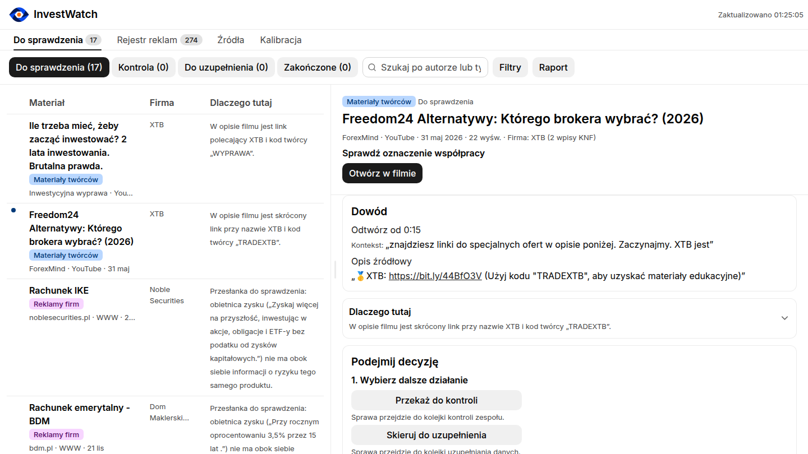

# Pokaz dla jury UKNF

**[Obejrzyj film U Źródła · 2:00](../../presentation/film/U-Zrodla-platformy-final.mp4).** Comparic nazywa brokera partnerem odcinka. ForexMind odsyła do ofert z kodem. Analityk porównuje dowody, a na końcu przekazuje pytanie o oznaczenie w obrazie do kontroli. Nagranie ma polskiego lektora i wtopione napisy.

Film pokazuje materiały twórców, reklamę funduszu i ofertę indywidualnego doboru portfela. Źródła mają różny zakres: wyszukiwanie YouTube korzysta z oficjalnego API, TikTok z podpisów wybranych publicznych osadzeń, a Instagram, Facebook i reklamy Meta z datowanej próbki zewnętrznej. Analityk rozstrzyga sprawę na podstawie dostępnego dowodu; brak odczytu nie oznacza braku treści.

Do samodzielnego przejścia spraw przygotuj stanowisko z prywatną paczką mediów według [instrukcji uruchomienia](../../README.md#uruchom-pokaz), a następnie otwórz [lokalny pulpit](http://127.0.0.1:8769/).

Stan pokazu z 21 XI 2026 zawiera **1 922 materiały, 274 wpisy w rejestrze reklam i 17 spraw do sprawdzenia**. W kolejce jest 7 materiałów twórców, 9 reklam firm i 1 oferta doradztwa. Pełną mowę odczytano w 23 z 1 307 filmów YouTube, a 1 284 mają status oczekiwania na transkrypcję. Rejestr obejmuje wpisy potwierdzone oraz pozycje do potwierdzenia. Liczniki pochodzą z projekcji kolejek i można je odczytać przez `GET /v1/overview?schema=2`.

W odrębnym stanie z 22 XI pulpit pokazuje **13 690 materiałów, 2 959 w rejestrze i 16 do sprawdzenia**. Rejestr obejmuje 2 411 wpisów potwierdzonych przez system i 548 kandydatów. Do rozszerzenia próby użyto m.in. wcześniejszych publikacji kanałów, na których system wcześniej znajdował współprace. Ten dobór wpływa na udział reklam w zbiorze.



## Sprawy do otwarcia na stanowisku

Kolejność i czasy w gotowym filmie zawiera [plan ujęć](../PITCH.md).

W filmie korzystamy z materiałów pozyskanych wcześniej i zapisujemy decyzję na osobnej kopii stanu. Na żywo przygotuj karty źródeł, rejestru i kalibracji przed rozpoczęciem pokazu.

| Scena | Na stanowisku |
| --- | --- |
| Pochodzenie | W **Źródłach** pokaż oficjalne API YouTube i `instagram.com/kacper.snela` w opisie filmu „Czy kiedykolwiek powinieneś sprzedać swoje ETF-y?”. Tą drogą odkryto 26 kont twórców. Przy postach z Instagrama i Facebooka oraz reklamach z Biblioteki reklam Meta wskaż datowaną próbkę zewnętrzną. W próbie reklam użyto filtra kraju emisji „Polska”. Przy TikToku pokaż odczyt podpisów z osadzeń publicznych profili. [Materiał źródłowy](https://www.youtube.com/watch?v=3TdtwBe7WxU) · [Zapis próbki](../lanes/2026-11-21-fable-k-social.md) |
| Rejestr reklam | W rejestrze reklam otwórz Comparic Rynki. Pokaż „znajdziecie u partnera tego odcinka XTB” i odsyłacz do 10:14. [Sprawa Comparic](http://127.0.0.1:8769/#register?case=youtube%3ACDk20n4u9Kk) |
| Do sprawdzenia | W **Do sprawdzenia** otwórz ForexMind. Pokaż kod TRADEXTB w opisie i odsyłacz do 0:15, gdzie autor mówi o linkach do specjalnych ofert. W opisie i dostępnej transkrypcji system nie znalazł oznaczenia współpracy. [Sprawa ForexMind](http://127.0.0.1:8769/#review?case=youtube%3AAqXHkxDzSDI) |
| Decyzja | Kliknij **Przekaż do kontroli** i wpisz, że trzeba sprawdzić oznaczenie w obrazie filmu. Po zatwierdzeniu wybierz **Otwórz w kontroli**. Pokaż zapisane uzasadnienie, kod i odsyłacz do 0:15. |
| Próba diagnostyczna | Pokaż osobną próbę diagnostyczną M1. Dwa zestawy ocen 8 filmów były zgodne co do klasy każdego filmu. Trzy jawne współprace trafiły do rejestru, pięć filmów nie dało przesłanki, a wzorzec nie zawierał żadnego przypadku do skierowania. Precyzja i pełność są w tej próbie nieobliczalne. [Dobór, zakres i wyniki próby](../lanes/2026-11-22-proba-kampanii.md) |
| Ostrzeżenie ETF | Na karcie ETF XTB pokaż „Otrzymuj dywidendy” i otwórz zapisany widok telefonu. Odczyt OCR wskazuje „ryzykowne” w ostrzeżeniu dotyczącym ETF. Karta mierzy odległość od informacji o dywidendach na 864 px. [Sprawa ETF XTB](http://127.0.0.1:8769/#review?module=M2&case=dom-xtb-etf) |
| Kalibracja | W **Kalibracji** wybierz **Reklamy firm** i podnieś próg z 30 do 50. Na 25 stronach ocenionych przez agenta liczba przeoczeń rośnie z 3 do 5, a kolejka w kopii pokazu zmniejsza się z 9 do 7. Wypadają pokazana przed chwilą strona ETF XTB (35 pkt) i strona kryptowalut OANDA TMS (40 pkt). [Próba M2](../lanes/2026-11-21-fable-e-m2.md) |

## Gdzie trafia sprawa

| Działanie urzędnika | Kolejka po zatwierdzeniu | Dalsze działanie |
| --- | --- | --- |
| **Przekaż do kontroli** | **Kontrola** | **Zakończ kontrolę** z wynikiem i jego podstawą albo **Wróć do sprawdzenia** z powodem. |
| **Skieruj do uzupełnienia** | **Do uzupełnienia** | **Dane uzupełnione** z opisem i źródłem albo **Wróć do sprawdzenia** z powodem. Sprawa wróci do **Do sprawdzenia**. |
| **Zakończ bez przesłanki** lub **Zakończ z innym uzasadnieniem** | **Zakończone** | W razie nowej informacji użyj **Wróć do sprawdzenia** i podaj powód. |

Karta najpierw pokazuje dostępne działania. Po wyborze wstawia edytowalny szkic na podstawie sprawy. Ustalenia kontroli, otrzymane dane i uzasadnienie zakończenia wpisuje urzędnik. Po zapisie pulpit przechodzi do kolejnej sprawy lub wraca do listy. Komunikat daje skrót do zapisanej sprawy w nowej kolejce, a zakładka **Historia decyzji** pokazuje poprzednie zapisy. Kolejki organizują dalszą pracę zespołu w aplikacji U Źródła. [Kontrakt API](contracts.md)

## Dodatkowe ujęcia przy 3–5 minutach

- **M2, porównanie.** Otwórz [kartę ETF XTB](http://127.0.0.1:8769/#review?module=M2&case=dom-xtb-etf). W wersji 390 px pokaż wzmiankę o dywidendach i ostrzeżenie dotyczące ETF poza początkowym kadrem. W widoku akcji XTB można sprawdzić ostrzeżenie dotyczące innego produktu. [Dowód i manifest](../zrodla-uknf/KRYTERIA-M2.md#dowód-w-działającym-m2)
- **M3, kontrola.** Pokaż wpis DM BOŚ z zakresem doradztwa, następnie kolizję nazwy FinanceWell. rdmwm.pl ma cytat o doborze proporcji portfela, a dalsza praca wymaga ustalenia operatora. [Próba M3](../lanes/2026-11-21-fable-f-m3.md) · [Kontrole](../archiwum/M3-WERYFIKACJA-2026-11-21.md)
- **Źródła.** Pokaż tabelę platform i pochodzenie odczytu. Facebook i Instagram są obecne dzięki datowanej próbce zewnętrznej i mechanizmowi importu. Odczyt przez oficjalne API Meta wymaga tokenu. [Monitoring](../MONITORING.md)
- **Raport.** W kolejce **Kontrola**, **Do uzupełnienia** albo **Zakończone** kliknij **Raport**. Możesz objąć eksportem wszystkie moduły lub wybrany moduł. CSV podaje etap, decyzję, uzasadnienie, sprawdzoną wersję i adres źródła. [Kontrakt API](contracts.md)
- **Powiadomienie.** Na kopii roboczej otwórz dwie połączone karty pulpitu. Zapisanie decyzji w pierwszej odświeża sprawę w drugiej. Powiadomienie o wysokim ryzyku pojawia się przy zwykłym skanie, gdy analiza zapisze nowe skierowanie.

## Przed pokazem

Do nagrania decyzji przygotuj osobną kopię z prywatnych paczek opisanych w README. Poniższa komenda tworzy nowy katalog danych na każdy dubel. Wybierz wolny port (w przykładzie 18769) i w adresach scenariusza zamień 8769 na numer tego portu.

```sh
mkdir -p .runtime
export INVESTWATCH_LOCAL_DIR="$(mktemp -d "$PWD/.runtime/nagranie-XXXXXX")"
export INVESTWATCH_PORT=18769
sh ops/demo/start-local.sh --demo
```

Po nagraniu wykonaj w tej samej powłoce `sh ops/demo/start-local.sh --stop`. Katalog zachowa zapis na potrzeby montażu. Dla następnego dubla uruchom powyższe polecenia ponownie.

- Potwierdź dostęp do zaakceptowanej kopii. Zapisz w konsoli wersję, tryb danych i liczniki z `GET /v1/overview?schema=2`.
- Otwórz kartę sprawy i kalibrację, zanim wystartuje zegar. Sprawdź desktop i telefon. Przećwicz zapis decyzji z dwiema otwartymi kartami na kopii roboczej.
- Kliknięcie publicznego odsyłacza **Otwórz od 0:15** wymaga dostępu do YouTube. W trybie offline pokaż znacznik i cytat w karcie.
- Wariant po tunelu wymaga połączenia z devboxem. Wariant lokalny wymaga paczek, a procedura dla Apple Silicon jest w [ops/mac/README.md](../../ops/mac/README.md).
- Gdy pulpit jest niedostępny, odtwórz [lokalny film](../../presentation/film/U-Zrodla-platformy-final.mp4).

## Pytania jury

| Pytanie | Odpowiedź |
| --- | --- |
| Co działa na żywo? | Decyzja, zmiana progu, eksport i WebSocket działają w bieżącej sesji. Dane pokazowe pochodzą z datowanego odtworzenia i pozyskanych wcześniej materiałów. Tryb live ma osobny harmonogram i zależy od dostępu do źródeł. |
| Czy system sam podejmuje decyzję? | System przygotowuje propozycję uzasadnienia z dowodów w karcie. Urzędnik wybiera działanie, edytuje tekst i zatwierdza zapis. Dla zakończenia lub zapisu ustaleń potrzebna jest własna podstawa. |
| Jak zmierzono trafność? | M1 ma 26 materiałów z 20 kampanii w zbiorze strojenia. Przy 60 reguły kwalifikacji dały 4 TP, 0 FP i 0 FN. Trzy pozytywne kampanie dotyczyły jednego reklamodawcy. Osobna próba ośmiu kontroli ujemnych nie dała podstaw do obliczenia precyzji ani pełności. M2 przy 30 na 25 stronach dał 9 TP, 0 FP, 13 TN i 3 FN. M3 obejmował 31 materiałów i jeden pozytyw. Wyniki pochodzą z etykiet agentów. [Próba diagnostyczna M1](../lanes/2026-11-22-proba-kampanii.md) |
| Gdzie jest AI? | Lokalny E5 wspomaga rozpoznawanie typu materiału. W pomiarze na 57 opisach z odłożonych kanałów miał 30 trafień wobec 13 dla słownika. Drugi głos ma walidator dosłownego cytatu. Kwalifikację wyznaczają udokumentowane reguły, a status wpisuje analityk. |
| Skąd pochodzą napisy? | Wyszukiwanie i metadane pochodzą z oficjalnego YouTube Data API. Próby z publicznymi napisami używały osobnej lokalnej ścieżki. We wdrożeniu potrzebne jest uzgodnione źródło transkrypcji, np. ASR z materiału udostępnionego do analizy. |
| Czy pokaz używa płatnego API? | Odtwarzanie i inferencja działają lokalnie. OpenRouter wykorzystano do wcześniejszych porównań modeli. Zapisana próbka Meta pochodzi od osobnego dostawcy danych. |
| Co po hackathonie? | Sprawdzić nowe kampanie z etykietami ekspertów, rozszerzyć uprawniony odczyt źródeł i zmierzyć skalowanie większej liczby kolektorów. [Audyt](../lanes/2026-11-22-odbior-finalny.md) |
